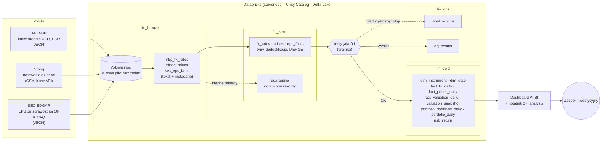
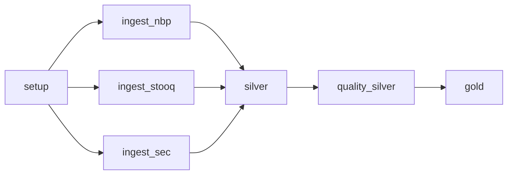

# Architektura i przepływ danych

## Job `fin-lakehouse-pipeline` (databricks.yml)

| Zadanie | Notatnik | Co robi | Ponawianie |
|---|---|---|---|
| setup | `00_setup` | schematy, Volume, test połączenia ze źródłami | – |
| ingest_nbp | `01_ingest_nbp` | kursy NBP → Bronze (przyrostowo) | 2× co 5 min |
| ingest_stooq | `02_ingest_stooq` | notowania → Bronze (przyrostowo, nakładka 7 dni) | 2× co 5 min |
| ingest_sec | `03_ingest_sec` | EPS z SEC → Bronze (raz dziennie na spółkę) | 2× co 5 min |
| silver | `04_silver` | Bronze → Silver (MERGE, kwarantanna) | – |
| quality_silver | `05_quality_silver` | 15 testów; błąd krytyczny zatrzymuje job | – |
| gold | `06_gold` | model analityczny + 7 testów spójności | – |

Harmonogram: dni robocze 7:30 (Europe/Warsaw) – po zamknięciu sesji w USA. W bundle job jest wstrzymany
(`PAUSED`), dopóki zespół nie włączy go w interfejsie.

## Ładowanie przyrostowe i idempotentność

| Warstwa | Mechanizm |
|---|---|
| Bronze (pobieranie) | znacznik przyrostu = ostatnia data w Bronze dla waluty / tickera; Stooq z nakładką 7 dni (korekty) |
| Silver | przetwarzane tylko rekordy Bronze z `_ingest_ts` > ostatnio przetworzonego; `MERGE` po kluczu biznesowym, aktualizacja tylko nowszą wersją |
| Gold | pełna, deterministyczna przebudowa z Silver (mały wolumen – prostsze i zawsze spójne) |

Tryb `full` (parametr joba / widżet `mode`) pobiera i przetwarza całą historię od `history_start`.

## Testy jakości danych

| Tabela | Test | Rodzaj reguły | Istotność |
|---|---|---|---|
| silver.fx_rates | not_null(currency, date, rate_mid) | kompletność | error |
| silver.fx_rates | unique(currency, date) | unikalność | error |
| silver.fx_rates | allowed_values(currency) – tylko waluty z konfiguracji | dozwolone wartości | error |
| silver.fx_rates | between(rate_mid, 0.5, 10) | zakres | error |
| silver.fx_rates | freshness(date, 7 dni) | aktualność | warn |
| silver.prices | not_null(ticker, date, close) | kompletność | error |
| silver.prices | unique(ticker, date) | unikalność | error |
| silver.prices | references(ticker → instruments.yml) | integralność referencyjna | error |
| silver.prices | all_present(ticker) – każdy instrument ma dane | kompletność | error |
| silver.prices | ohlc_consistent – low ≤ open/close ≤ high | reguła dziedzinowa | warn |
| silver.prices | abs_daily_return ≤ 50% | reguła dziedzinowa | warn |
| silver.prices | freshness(date, 7 dni) | aktualność | warn |
| silver.eps_facts | unique(cik, period_start, period_end, accn) | unikalność | error |
| silver.eps_facts | all_present(cik) – każda spółka z USA ma roczny EPS | kompletność | error |
| silver.eps_facts | eps_restatement_split_suspect | reguła dziedzinowa | warn |
| gold.fact_prices_daily | not_null(fx_rate, close_pln) | kompletność | error |
| gold.fact_prices_daily | unique(ticker, date) | unikalność | error |
| gold.portfolio_daily | n_positions = liczba pozycji portfela | kompletność | error |
| gold.portfolio_daily | value_pln > 0 | zakres | error |
| gold.risk_return | unique(ticker) | unikalność | error |
| gold.fact_valuation_daily | between(pe_ratio, 0, 300) | zakres | warn |
| gold.valuation_snapshot | eps_age_days ≤ 550 | aktualność | warn |

Dodatkowo walidacja konfiguracji przy starcie (wagi sumują się do 1, waluty mają kurs NBP, pozycje portfela
istnieją w słowniku) oraz reguły kwarantanny w Silver (niepoprawna data, liczba, brak klucza, cena ≤ 0).
